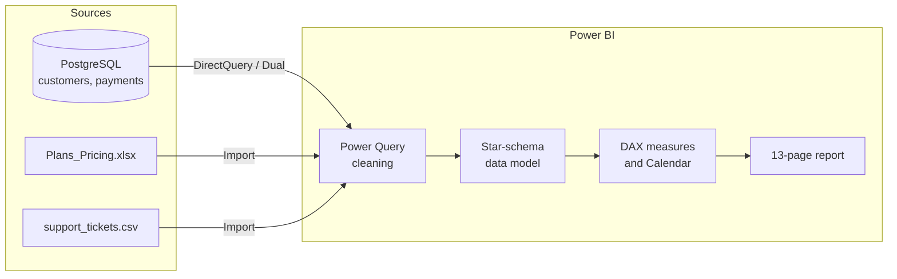
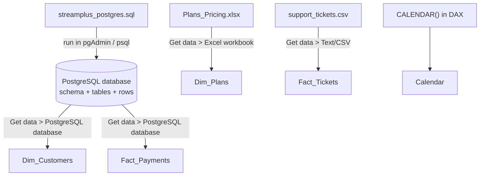
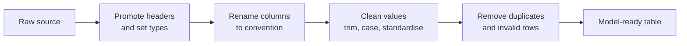
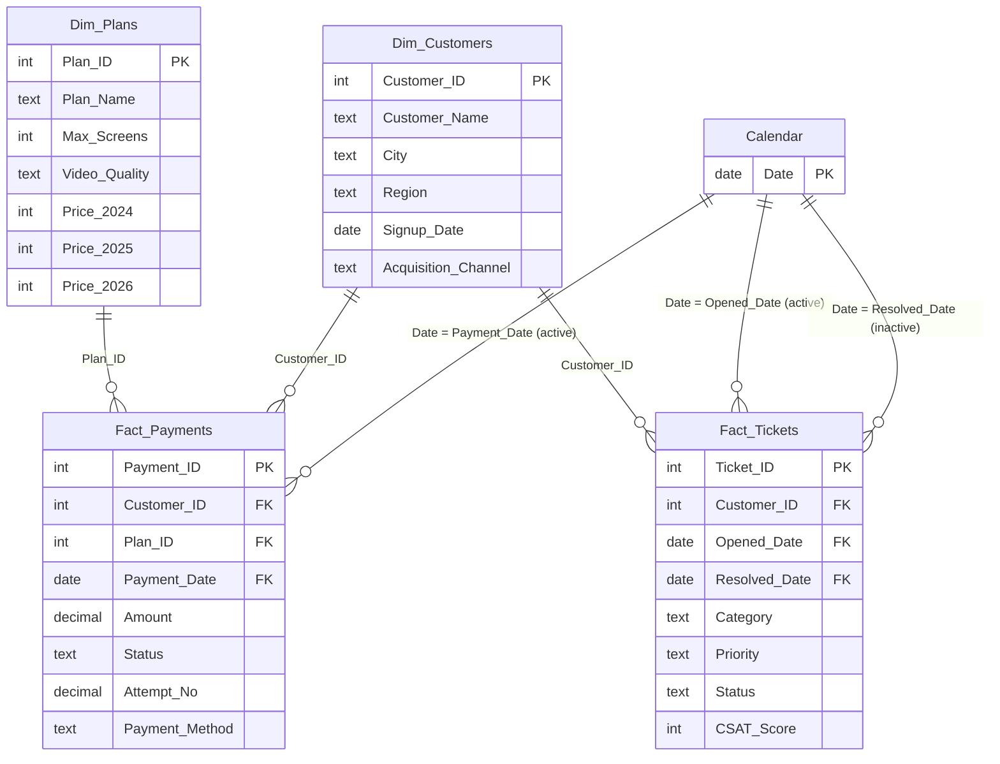

<div align="center">

# StreamPlus Subscription Analysis

**An end-to-end Power BI project: PostgreSQL, Excel and CSV sources, Power Query cleaning, a star-schema model, DAX measures and a 13-page interactive report answering 12 business questions.**


[Overview](#1-project-overview) &nbsp;|&nbsp;
[Data](#2-data) &nbsp;|&nbsp;
[Data Transformation](#3-data-transformation) &nbsp;|&nbsp;
[Data Modelling](#4-data-modelling) &nbsp;|&nbsp;
[Reproduce](#5-data-quality-and-reproduction)

</div>

---

## Table of Contents

| Section | What you will find |
|---|---|
| [1. Project Overview](#1-project-overview) | Business goal, tech stack, repository layout, architecture |
| [2. Data](#2-data) | Every table, where it lives, how it is fetched, data dictionary |
| [3. Data Transformation](#3-data-transformation) | Power Query cleaning steps for each table |
| [4. Data Modelling](#4-data-modelling) | Model diagram, relationships, storage modes, all DAX, the 12 questions with visuals and results |
| [5. Data Quality and Reproduction](#5-data-quality-and-reproduction) | Known issues and how to rebuild the project locally |

---

## 1. Project Overview

StreamPlus is a fictional video-streaming service. This project analyses its subscribers, plans, payments and customer-support tickets to answer **12 strategic questions** across three themes.

| Theme | Questions | Focus |
|---|---|---|
| Customer and Revenue Analytics | 1 - 4 | Revenue growth, acquisition channels, regional spread, top customers |
| Support Ticket and Satisfaction Analytics | 5 - 8 | CSAT, ticket workload, resolution speed, urgent tickets |
| Advanced Business Logic | 9 - 12 | Payment success rate, plan popularity, month-over-month growth, ticket seasonality |

### Tech stack

| Layer | Tool |
|---|---|
| Storage and loading | PostgreSQL (pgAdmin / psql), Excel, CSV |
| Cleaning | Power Query (M language) |
| Modelling and calculation | Power BI data model, DAX |
| Visualisation | Power BI Desktop |

### Repository layout

```text
StreamPlus/
|-- ER_Diagram/
|   `-- ER-Diagram.png            Entity-relationship diagram of the PostgreSQL schema
|-- queries/
|   `-- streamplus_postgres.sql   Builds the database, schema, tables and rows
|-- raw_data/
|   |-- Plans_Pricing.xlsx        Subscription plans and prices
|   `-- support_tickets.csv       Customer support tickets
|-- report/
|   `-- StreamPlusProject.pbix    Power BI report (model, measures, visuals)
|-- screenshots/                  Report page images used in this README
`-- README.md
```

### Architecture



[Back to top](#streamplus-subscription-analysis)

---

## 2. Data

The project deliberately combines three source types so that the report demonstrates connecting to a database, a spreadsheet and a flat file.

### 2.1 Source inventory

| Table | Role | Source | Location in repository | Load mode | Approx. rows |
|---|---|---|---|---|---|
| `Dim_Plans` | Dimension | Excel | `raw_data/Plans_Pricing.xlsx` | Import | 4 |
| `Dim_Customers` | Dimension | PostgreSQL | `queries/streamplus_postgres.sql` | Dual | about 5,000 |
| `Fact_Payments` | Fact | PostgreSQL | `queries/streamplus_postgres.sql` | DirectQuery | about 40,360 |
| `Fact_Tickets` | Fact | CSV | `raw_data/support_tickets.csv` | Import | about 920 after cleaning |
| `Calendar` | Date dimension | Created in DAX | Inside the `.pbix` | Calculated | 1,096 |
| `_Measures` | Measure container | Empty table | Inside the `.pbix` | None | Holds all DAX measures |

### 2.2 How each source reaches the report



1. **PostgreSQL.** The SQL script creates the database, schema and tables and inserts all rows. Power BI connects with *Get data > PostgreSQL database* and navigates to the customer and payment tables.
2. **Excel.** The plans workbook is loaded with *Get data > Excel workbook*.
3. **CSV.** The ticket file is loaded with *Get data > Text/CSV*.
4. **Calendar.** Generated inside the model with the `CALENDAR` function (see [4.3](#43-calendar-table)).

### 2.3 Data dictionary

<details>
<summary><strong>Dim_Plans</strong> - the subscription plans offered</summary>

| Column | Type | Description |
|---|---|---|
| `Plan_ID` | Whole number, primary key | 1 = Mobile, 2 = Basic, 3 = Standard, 4 = Premium |
| `Plan_Name` | Text | Name of the plan |
| `Max_Screens` | Whole number | Simultaneous screens allowed |
| `Video_Quality` | Text | 480p, 720p, 1080p or 4K |
| `Price_2024`, `Price_2025`, `Price_2026` | Whole number | Monthly price in each year |

</details>

<details>
<summary><strong>Dim_Customers</strong> - one row per subscriber</summary>

| Column | Type | Description |
|---|---|---|
| `Customer_ID` | Whole number, primary key | Unique customer identifier |
| `Customer_Name` | Text | Full name (names repeat across customers) |
| `City` | Text | City of residence |
| `Region` | Text | North, South, East, West or Central |
| `Signup_Date` | Date | Date the customer joined |
| `Acquisition_Channel` | Text | Organic, Ads, Referral or Partner |

</details>

<details>
<summary><strong>Fact_Payments</strong> - one row per payment attempt</summary>

| Column | Type | Description |
|---|---|---|
| `Payment_ID` | Whole number, primary key | Unique payment identifier |
| `Customer_ID` | Whole number, foreign key | Links to `Dim_Customers` |
| `Plan_ID` | Whole number, foreign key | Links to `Dim_Plans` |
| `Payment_Date` | Date | Date of the attempt, links to `Calendar` |
| `Amount` | Decimal | Amount charged |
| `Status` | Text | Outcome of the attempt, with `Success` as the successful value |
| `Attempt_No` | Decimal | Retry counter |
| `Payment_Method` | Text | Method used to pay |

</details>

<details>
<summary><strong>Fact_Tickets</strong> - one row per support ticket</summary>

| Column | Type | Description |
|---|---|---|
| `Ticket_ID` | Whole number, primary key | Unique ticket identifier |
| `Customer_ID` | Whole number, foreign key | Links to `Dim_Customers` |
| `Opened_Date` | Date | Ticket creation date, active link to `Calendar` |
| `Resolved_Date` | Date | Closure date, null for open tickets, inactive link to `Calendar` |
| `Category` | Text | Account, Billing, Content or Playback |
| `Priority` | Text | High, Medium or Low |
| `Status` | Text | Open or Resolved |
| `CSAT_Score` | Whole number | Customer satisfaction rating |
| `Resolution_Time` | Calculated column | Days between opened and resolved dates |

</details>

[Back to top](#streamplus-subscription-analysis)

---

## 3. Data Transformation

All cleaning is done in Power Query so that the raw files and the database stay untouched. The steps below follow the *Applied Steps* pane of each query.



### 3.1 Summary by table

| Table | Main goal | Steps applied |
|---|---|---|
| `Dim_Plans` | Turn a spreadsheet into a clean lookup | Navigation, change column type, remove unwanted rows, use first row as headers, change data types, move `Plan_ID` to first column, rename columns to `Title_Case` |
| `Dim_Customers` | Consistent, usable customer records | Navigation, rename every column to the project convention, remove unnecessary connection columns, trim text, filter out null and blank customer names |
| `Fact_Payments` | Lean payment fact table | Navigation, remove the connection columns added by the PostgreSQL navigator, rename columns to convention, filter rows |
| `Fact_Tickets` | Reliable ticket facts | Promote headers, change types, rename CSAT column, remove duplicates, capitalise `Priority`, trim leading and trailing spaces, restrict `Priority` to High, Medium, Low, standardise and capitalise `Category` (each word), convert date columns, filter rows, rename columns |

### 3.2 Detailed steps

<details>
<summary><strong>Dim_Plans</strong></summary>

| Step | Purpose |
|---|---|
| Source, Navigation | Connect to the workbook and select the sheet |
| Changed column type | Initial type detection |
| Removing the unwanted rows | Drop title and blank rows above the table |
| Transforming rows and columns | Reshape the sheet into a table |
| Used the first row as the table header | Promote real headers |
| Changed the data type | Whole numbers for IDs, screens and prices, text for names and quality |
| Made sure `Plan_ID` is the first column | Key column first for readability |
| Renamed Columns | `Plan_ID`, `Max_Screens`, `Video_Quality`, `Price_2024`, `Price_2025`, `Price_2026` |

</details>

<details>
<summary><strong>Dim_Customers</strong></summary>

| Step | Purpose |
|---|---|
| Source, Navigation | Connect to PostgreSQL and select the customers table |
| Renamed each column as per convention | `Customer_ID`, `Customer_Name`, `City`, `Region`, `Signup_Date`, `Acquisition_Channel` |
| Got rid of the unnecessary columns | Remove navigator relationship columns |
| Filtered Rows | Remove invalid rows |
| Trimmed Text | Remove stray spaces from text columns |
| Filtered Rows 1, 2 | Keep only rows where `Customer_Name` is neither null nor empty |

</details>

<details>
<summary><strong>Fact_Payments</strong></summary>

| Step | Purpose |
|---|---|
| Source, Navigation | Connect to PostgreSQL and select the payments table |
| Got rid of the connection columns | Remove navigator relationship columns |
| Renamed each column as per convention | `Payment_ID`, `Customer_ID`, `Plan_ID`, `Payment_Date`, `Amount`, `Status`, `Attempt_No`, `Payment_Method` |
| Filtered Rows | Row-level filter (`each true` in the final preview) |

Because this table is in DirectQuery mode, only transformations that can be translated to SQL are kept, so it has the shortest step list.

</details>

<details>
<summary><strong>Fact_Tickets</strong></summary>

| Step | Purpose |
|---|---|
| Promoted headers, Changed column type | Read the CSV correctly |
| Renamed the CSAT column | `CSAT_Score` |
| Removed Duplicates (twice) | Keep one row per ticket |
| Changed the resolved date type | Convert `Resolved_Date` to a date |
| Priority column capitalised | Consistent casing |
| Deleted leading and trailing spaces | Prevent mismatched values |
| Made sure Priority is only High, Medium or Low | Remove invalid priority values |
| Category column formalised and capitalised each word | Account, Billing, Content, Playback |
| Filtered Rows (several) | Remove invalid or incomplete records |
| Opened date column made consistent | Align date type with the Calendar relationship |
| Renamed Columns | Final naming convention |

`Resolved_Date` is intentionally left null for open tickets, because null means "not yet resolved".

</details>

[Back to top](#streamplus-subscription-analysis)

---

## 4. Data Modelling

This section covers the data model, relationships, calculation layer (all DAX) and how each of the 12 questions is answered.

**Jump to:** [4.1 Model](#41-model-diagram) | [4.2 Relationships](#42-relationships-and-filters) | [4.3 Calendar](#43-calendar-table) | [4.4 DAX](#44-dax-reference) | [4.5 Questions](#45-the-12-business-questions)

### 4.1 Model diagram

The model is a **star schema**: two fact tables surrounded by shared dimensions.


*Model view of `StreamPlusProject.pbix`. Add `screenshots/model_view.png` to the repository.*

The same structure as a diagram that renders directly on GitHub:



The database-side design is documented in [`ER_Diagram/ER-Diagram.png`](ER_Diagram/ER-Diagram.png).

### 4.2 Relationships and filters

| # | One side | Many side | Cardinality | Filter direction | Active |
|---|---|---|---|---|---|
| 1 | `Dim_Plans[Plan_ID]` | `Fact_Payments[Plan_ID]` | One-to-many | Single (dimension to fact) | Yes |
| 2 | `Dim_Customers[Customer_ID]` | `Fact_Payments[Customer_ID]` | One-to-many | Single | Yes |
| 3 | `Dim_Customers[Customer_ID]` | `Fact_Tickets[Customer_ID]` | One-to-many | Single | Yes |
| 4 | `Calendar[Date]` | `Fact_Payments[Payment_Date]` | One-to-many | Single | Yes |
| 5 | `Calendar[Date]` | `Fact_Tickets[Opened_Date]` | One-to-many | Single | Yes |
| 6 | `Calendar[Date]` | `Fact_Tickets[Resolved_Date]` | One-to-many | Single | No |

**How filtering behaves**

- **Dimension to fact.** Choosing a region, channel, plan or month filters the payments and tickets that belong to it.
- **One active date path per table.** `Fact_Tickets` has two date columns, so `Opened_Date` is active and `Resolved_Date` is inactive. Measures that need resolved dates activate it with `USERELATIONSHIP`.
- **Plans and customers are not linked.** `Dim_Plans` filters only `Fact_Payments`. Any "customers per plan" count must therefore go through the payments table.

**Storage modes**

| Table | Mode | Reason |
|---|---|---|
| `Fact_Payments` | DirectQuery | Largest table, queried live from PostgreSQL |
| `Dim_Customers` | Dual | Related to a DirectQuery table, so it can serve both import and live queries |
| `Dim_Plans`, `Fact_Tickets`, `Calendar` | Import | Small, file-based or calculated |

This combination is why the status bar shows *Storage Mode: Mixed*.

### 4.3 Calendar table

```DAX
Calendar = CALENDAR(DATE(2024, 1, 1), DATE(2026, 12, 31))
```

| Column | Example | Use |
|---|---|---|
| `Date` | 01-01-2024 | Relationship key |
| `Day` | 1 | Day of month |
| `MonthNumber` | 1 | Numeric month |
| `MonthName` | January | Month label |
| `Year` | 2024 | Yearly trends |
| `Quarter` | Q1 | Quarter label |
| `Quarter-Year` | 2024Q1 | Quarterly trends |
| `QuarterYearSort` | 202401 | Sort key for `Quarter-Year` |
| `Month-Year` | Jan 2024 | Monthly trends |
| `MonthYearSort` | 202401 | Sort key for `Month-Year` |

The table spans three full years (1,096 rows) and is marked as the date table, which time-intelligence functions such as `DATEADD` require.

### 4.4 DAX reference

All measures live in the `_Measures` table.

> **Note for the author:** `Urgent_Monitoring_Live` and `Total_Successful_Payments` are copied from the report. The other formulas are reconstructed from measure names and visual behaviour. Replace them with the exact text from your model (DAX query view: `EVALUATE INFO.MEASURES()`) before publishing.

#### Revenue and payments

```DAX
Total_Payment_Amount =
SUM ( Fact_Payments[Amount] )

Total_Successful_Payment_Amount =
CALCULATE ( [Total_Payment_Amount], Fact_Payments[Status] = "Success" )

Total_Payments_Count =
COUNTROWS ( Fact_Payments )

Total_Successful_Payments =
CALCULATE ( COUNTROWS ( Fact_Payments ), Fact_Payments[Status] = "Success" )

Successful_Payment_Rate =
DIVIDE ( [Total_Successful_Payments], [Total_Payments_Count] )
```

#### Customers

```DAX
Total_Customers =
COUNTROWS ( Dim_Customers )
```

#### Support and satisfaction

```DAX
Average_CSAT_Score =
AVERAGE ( Fact_Tickets[CSAT_Score] )

Total Tickets =
COUNTROWS ( Fact_Tickets )

Urgent_Monitoring_Live =
CALCULATE (
    COUNTROWS ( Fact_Tickets ),
    Fact_Tickets[Status] = "Open",
    Fact_Tickets[Priority] = "High"
)
```

#### Time intelligence

```DAX
Previous_Month_Total_Revenue =
CALCULATE ( [Total_Successful_Payment_Amount], DATEADD ( Calendar[Date], -1, MONTH ) )

Month-Over-Month Growth Rate =
DIVIDE (
    [Total_Successful_Payment_Amount] - [Previous_Month_Total_Revenue],
    [Previous_Month_Total_Revenue]
)
```

#### Calculated column

```DAX
Resolution_Time =
DATEDIFF ( Fact_Tickets[Opened_Date], Fact_Tickets[Resolved_Date], DAY )
```

#### Other helper measures present in the model

| Measure | Purpose |
|---|---|
| `Total_CSAT_Score` | Sum of CSAT scores |
| `Payment_Method_Count` | Payments per method |
| `Payment_Status_Count` | Payments per status |

### 4.5 The 12 business questions

Each question below shows what was asked, how it was answered, the visual used and what it shows. Click a question to expand it.

| # | Question | Visual | Page |
|---|---|---|---|
| 1 | Revenue growth over time | Line chart | revenue Page |
| 2 | Acquisition channel efficiency | Donut chart | Acquisition_Channel |
| 3 | Regional customer distribution | Donut and matrix | Regional Customer Distribution |
| 4 | High-value customers | Table | premium Customers |
| 5 | Overall support performance | Card | Customer Satisfaction |
| 6 | Support workload by category | Treemap | Customer Satisfaction |
| 7 | Resolution speed vs satisfaction | Scatter plot | Resolve Days vs Rating |
| 8 | Urgent ticket monitoring | KPI card | Urgent_Monitoring |
| 9 | Payment success rate | Gauge | Successful_Payment_Rate |
| 10 | Popularity of streaming quality tiers | Clustered column | Video Quality wise Popularity |
| 11 | Month-over-month revenue growth | Waterfall | Month-over-month growth |
| 12 | Support ticket seasonality | Area chart | Ticket_Seasonality |

---

#### Step 1: Customer and Revenue Analytics

<details>
<summary><strong>Q1. Plan revenue growth over time</strong></summary>

| | |
|---|---|
| **Question** | How is subscription revenue changing across years, quarters and months? |
| **Measure** | `Total_Payment_Amount` |
| **Tables used** | `Fact_Payments`, `Calendar` |
| **Visual** | Three line charts: by `Year`, by `Quarter-Year`, by `Month-Year` |

**How it is answered.** `SUM` over `Fact_Payments[Amount]` is plotted against three levels of the Calendar hierarchy. The active Payment_Date relationship does the filtering.

**Result.** Revenue rises steadily with no sharp breaks, from roughly 2M in 2024 to roughly 10M in 2026 on the yearly view. Quarterly and monthly lines confirm the same smooth upward trend. Total successful revenue across the period is about 20M.


</details>

<details>
<summary><strong>Q2. Acquisition channel efficiency</strong></summary>

| | |
|---|---|
| **Question** | Which marketing sources bring in the most subscribers? |
| **Measure** | `Total_Customers` |
| **Tables used** | `Dim_Customers` |
| **Visual** | Donut chart by `Acquisition_Channel` |

**How it is answered.** `COUNTROWS` on the customer dimension, split by channel.

**Result.**

| Channel | Share of customers |
|---|---|
| Organic | 35.3% |
| Ads | 30.7% |
| Referral | 19.0% |
| Partner | 15.1% |

Organic and paid advertising together bring in about two thirds of subscribers.


</details>

<details>
<summary><strong>Q3. Regional customer distribution</strong></summary>

| | |
|---|---|
| **Question** | Where are the primary customer locations? |
| **Measure** | `Total_Customers` (reused) |
| **Tables used** | `Dim_Customers` |
| **Visual** | Donut by `Region`, and a matrix with `Region > City` on rows and `Acquisition_Channel` on columns |

**How it is answered.** The same customer count is reused and sliced by geography. A matrix was chosen over a filled map because `Region` values such as North or Central cannot be geocoded.

**Result.**

| Region | Share of customers |
|---|---|
| North | 27.0% |
| West | 26.1% |
| South | 24.1% |
| East | 14.2% |
| Central | 8.6% |

North, West and South hold about 77% of customers. Central is the smallest region. The matrix shows Organic is the leading channel in most cities.


</details>

<details>
<summary><strong>Q4. High-value customers</strong></summary>

| | |
|---|---|
| **Question** | Who are the top revenue-generating customers for loyalty tracking? |
| **Measure** | `Total_Payment_Amount` |
| **Tables used** | `Dim_Customers`, `Fact_Payments` |
| **Visual** | Table with `Customer_Name` and `Total_Payment_Amount`, sorted descending, top 10 |

**How it is answered.** The customer dimension filters the payments fact, so the revenue measure is calculated per customer and then sorted.

**Result.** The top customers are Diya Chauhan (104,169), Isha Kulkarni (99,744) and Pooja Verma (94,999). The first row of the table has a blank name: payments whose customer ID has no match in `Dim_Customers` are grouped there (see [data quality](#5-data-quality-and-reproduction)).


</details>

---

#### Step 2: Support Ticket and Satisfaction Analytics

<details>
<summary><strong>Q5. Overall support team performance</strong></summary>

| | |
|---|---|
| **Question** | What is the global average customer satisfaction rating? |
| **Measure** | `Average_CSAT_Score` |
| **Tables used** | `Fact_Tickets` |
| **Visual** | Card |

**How it is answered.** `AVERAGE` over `CSAT_Score`. Tickets without a rating are ignored automatically.

**Result.** The average satisfaction score is **3.68**.


</details>

<details>
<summary><strong>Q6. Support workload by category</strong></summary>

| | |
|---|---|
| **Question** | Which departments receive the most issues? |
| **Measure** | `Total Tickets` |
| **Tables used** | `Fact_Tickets` |
| **Visual** | Treemap by `Category` |

**How it is answered.** `COUNTROWS` on the ticket table, grouped by category.

**Result.** Playback is the largest category, followed by Billing and Account. Content is the smallest.


</details>

<details>
<summary><strong>Q7. Resolution speed vs satisfaction</strong></summary>

| | |
|---|---|
| **Question** | Do longer resolution times lower customer ratings? |
| **Fields** | Calculated column `Resolution_Time`, `Average_CSAT_Score` |
| **Tables used** | `Fact_Tickets` |
| **Visual** | Scatter plot, X axis `Resolution_Time`, Y axis average CSAT |

**How it is answered.** `DATEDIFF` creates a day count per ticket, which is used as the X axis. Open tickets have no resolved date and drop out.

**Result.** Resolution times range from 0 to 5 days and average ratings from about 3.5 to 4.25. Same-day and 2-day resolutions score highest, and 3-day resolutions score lowest, but there is no consistent decline as days increase. Resolution time alone is therefore a weak predictor of satisfaction in this data.


</details>

<details>
<summary><strong>Q8. Urgent ticket monitoring</strong></summary>

| | |
|---|---|
| **Question** | How many high-priority tickets are still unresolved? |
| **Measure** | `Urgent_Monitoring_Live` |
| **Tables used** | `Fact_Tickets` |
| **Visual** | KPI card |

**How it is answered.** `CALCULATE` applies two filters at once: `Status = "Open"` and `Priority = "High"`.

**Result.** The card currently displays a blank value, meaning no ticket is both open and high priority in the loaded data. Appending `+ 0` to the measure makes the card show 0 instead of a dash.


</details>

---

#### Step 3: Advanced Business Logic

<details>
<summary><strong>Q9. Payment success rate</strong></summary>

| | |
|---|---|
| **Question** | What percentage of payment attempts succeed? |
| **Measures** | `Total_Successful_Payments`, `Total_Payments_Count`, `Successful_Payment_Rate` |
| **Tables used** | `Fact_Payments` |
| **Visual** | Gauge, supported by three cards |

**How it is answered.** `DIVIDE` takes successful attempts over all attempts and handles division by zero safely.

**Result.**

| Metric | Value |
|---|---|
| Successful payments | 37,992 |
| All payment attempts | 40,360 |
| Success rate | **94.13%** |


</details>

<details>
<summary><strong>Q10. Popularity of streaming quality tiers</strong></summary>

| | |
|---|---|
| **Question** | Which video-quality plan do users prefer? |
| **Field** | Distinct count of `Customer_ID` from `Fact_Payments` |
| **Tables used** | `Fact_Payments`, `Dim_Plans` |
| **Visual** | Clustered column chart by `Plan_ID` |

**How it is answered.** Because `Dim_Plans` filters only the payments table, customers are counted from `Fact_Payments` using a distinct count. Plan IDs map to quality as 1 = 480p (Mobile), 2 = 720p (Basic), 3 = 1080p (Standard), 4 = 4K (Premium).

**Result.** Basic (720p) is the most popular tier with roughly 1,700 customers, followed by Mobile (480p) and Standard (1080p). Premium (4K) is the least popular at roughly 900 customers. Customers who changed plans can appear under more than one tier.


</details>

<details>
<summary><strong>Q11. Month-over-month revenue growth</strong></summary>

| | |
|---|---|
| **Question** | How does revenue change between consecutive months? |
| **Measures** | `Total_Successful_Payment_Amount`, `Previous_Month_Total_Revenue`, `Month-Over-Month Growth Rate` |
| **Tables used** | `Fact_Payments`, `Calendar` |
| **Visual** | Table of month, revenue, previous month, growth rate, plus a waterfall chart |

**How it is answered.** `CALCULATE` with `DATEADD(Calendar[Date], -1, MONTH)` shifts the filter context back one month. The growth rate is the difference divided by the previous month.

**Result.** Growth is strongest early in the series (for example 33.1% in February 2024 and 39.2% in April 2024) and slows to low single-digit percentages by 2026. The final month shows a decline, which is consistent with an incomplete month of data.


</details>

<details>
<summary><strong>Q12. Support ticket seasonality</strong></summary>

| | |
|---|---|
| **Question** | Do complaints spike at predictable times of the year? |
| **Measure** | `Total Tickets` |
| **Tables used** | `Fact_Tickets`, `Calendar` |
| **Visual** | Area chart by `Month-Year` |

**How it is answered.** The ticket count is plotted against the monthly Calendar column through the active `Opened_Date` relationship.

**Result.** Monthly tickets climb from under 10 in early 2024 to around 30 by mid-2024, then stay between roughly 28 and 32 through 2025 and 2026. There is no repeating annual spike, so the data shows a ramp-up followed by a stable plateau rather than seasonality. The last month dips because it is incomplete.


</details>

[Back to top](#streamplus-subscription-analysis)

---

## 5. Data Quality and Reproduction

### 5.1 Known data observations

| Observation | Effect on the report |
|---|---|
| A few payments are exactly 10 times the plan price (for example 1,490 on a 149 plan, 7,990 on a 799 plan) | Slightly inflates revenue and top-customer values |
| Some customer IDs in payments and tickets do not exist in `Dim_Customers` (for example 900004, 900006) | Appear as a blank customer in visuals such as Q4 |
| `City` contains mixed casing (`MUMBAI`, `raipur`, `surat`) | Cities appear as separate or inconsistently formatted labels in the matrix |
| Customer names repeat across customers | Rankings should include `Customer_ID` to avoid merging two people |
| Open tickets have no resolved date or rating | Excluded from CSAT averages and resolution-time analysis |
| The last month of data is incomplete | Final point in the growth and ticket charts dips |

### 5.2 Reproduce the project


1. **Clone** this repository.
2. **Build the database.** Run `queries/streamplus_postgres.sql` in pgAdmin or `psql`. It creates the schema, tables and rows (see `ER_Diagram/ER-Diagram.png`).
3. **Open** `report/StreamPlusProject.pbix` in Power BI Desktop.
4. **Update data sources** under *Home > Transform data > Data source settings*:
   - PostgreSQL: your server name, database and credentials
   - Excel: path to `raw_data/Plans_Pricing.xlsx`
   - CSV: path to `raw_data/support_tickets.csv`
5. **Refresh** the model. `Fact_Payments` uses DirectQuery, so PostgreSQL must be running.

> Credentials are stored per machine by Power BI and are not committed to this repository.

### 5.3 Possible improvements

- Plot absolute monthly revenue change in the waterfall instead of growth percentage.
- Add a month-of-year chart with year as the legend to test seasonality properly.
- Standardise `City` values and resolve orphan customer IDs at the source.
- Add churn, monthly recurring revenue and customer lifetime value measures.

---

<div align="center">

**Author:** Rajdeep Ray

[Back to top](#streamplus-subscription-analysis)

</div>
